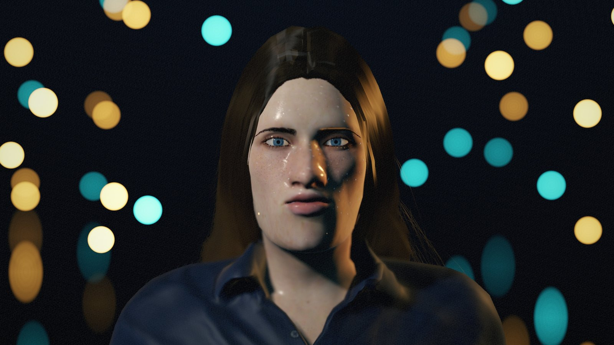
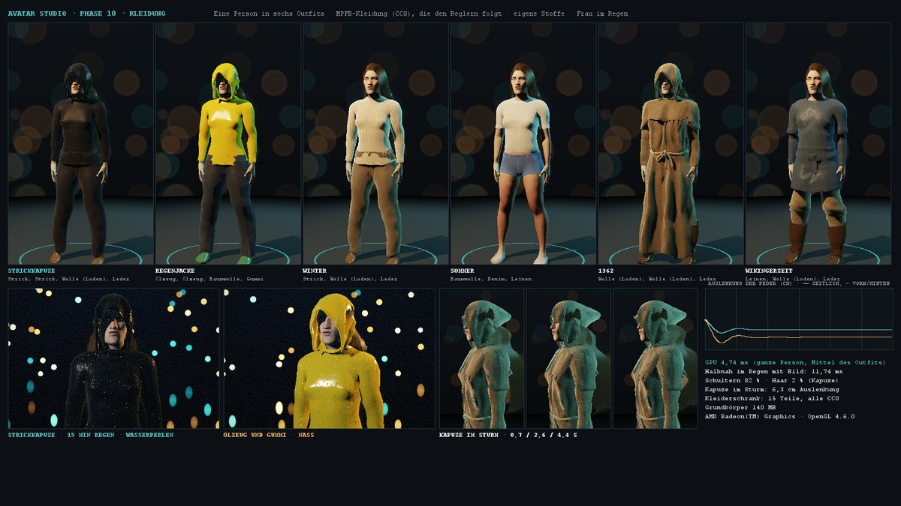
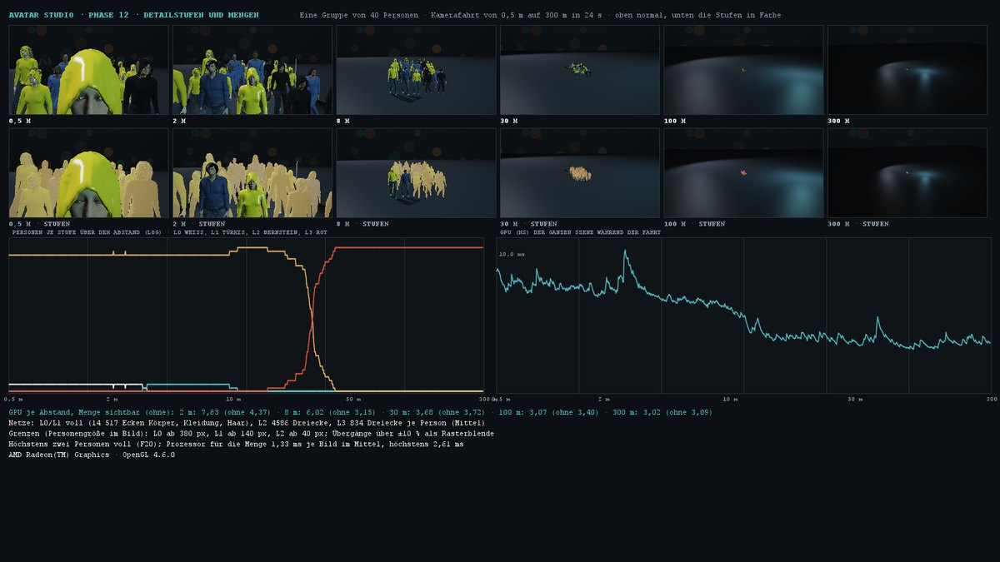
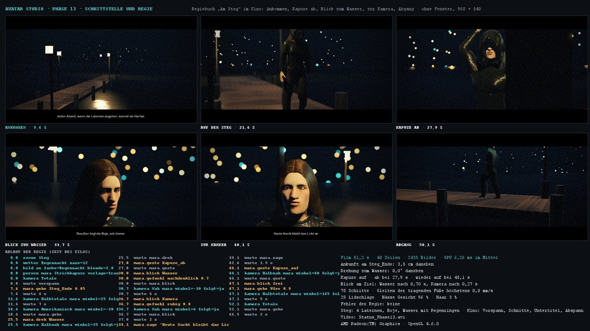
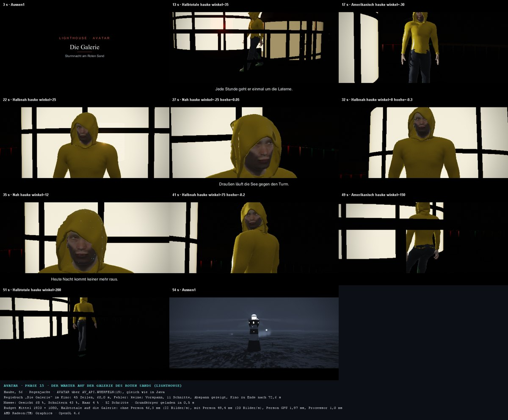
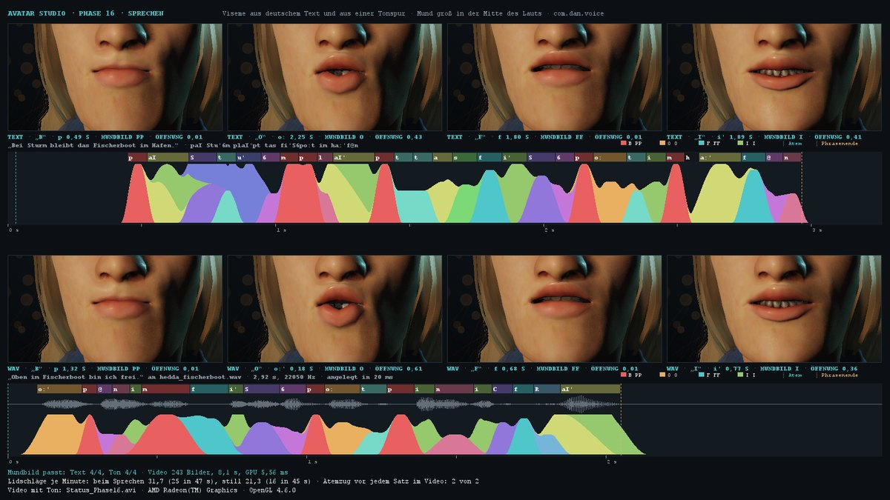
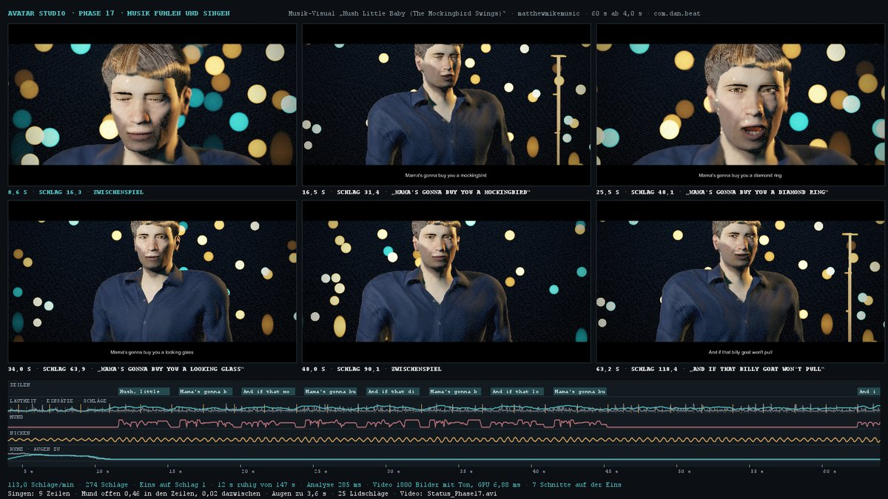
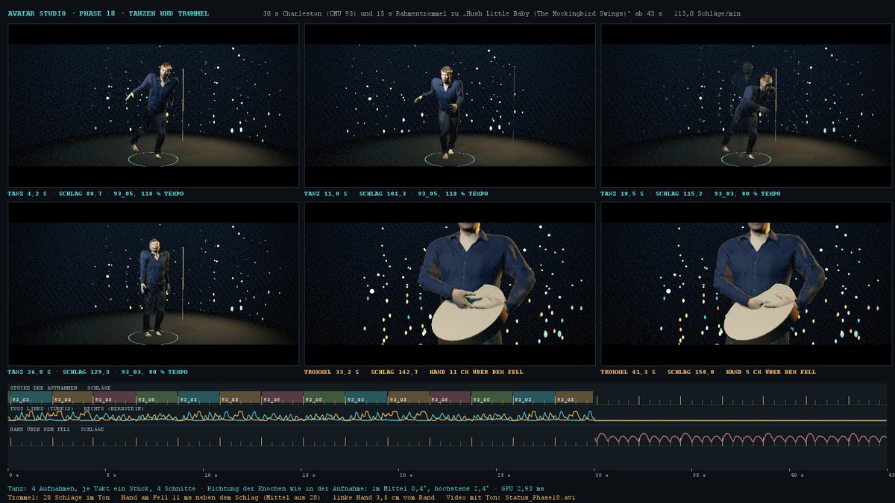
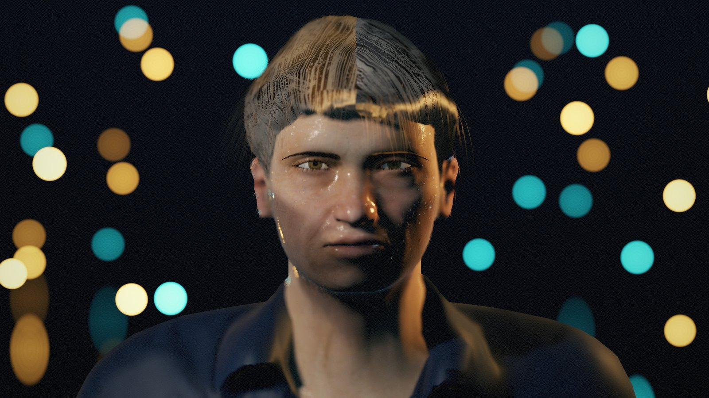

# Avatar – Ein Gesicht im Regen

Ein Mensch für alle Szenen: männlich oder weiblich, jung oder alt, aus der Nähe glaubhaft. Man sieht die Poren, die
Sommersprossen, das Licht, das durch die Ohren schimmert, den Tropfen auf der Wange, die nassen Strähnen vor der Stirn.
Und der Avatar lebt, auch wenn er nichts tut: Er atmet, blinzelt, lässt den Blick wandern und verlagert das Gewicht. In
der Kür spricht er, singt, nickt im Takt, tanzt und schlägt eine Handtrommel. Der Grundkörper kommt aus Blender (MPFB2,
Inhalte frei nach CC0); alles, was ihn lebendig macht, ist eigener Code in Java 21 mit OpenGL (JOGL): Haut, Augen,
Haare, Mimik, Blick, Nässe, Licht, Bild, Sprechen, Musik und Tanz. Weil er aus Packages gebaut ist wie `rain` oder
`kino`, kann er in jede Szene; die erste ist Lighthouse (der Wärter auf der Galerie).

*Porträt im Regen nach fünf Minuten bei 5 mm/h: Streuung der Haut, nasse Haut und Strähnen, Tropfen, Lichter in Bernstein
und Türkis als Zerstreuungskreise (Phase 9).*

## Die Packages

Jedes Package folgt demselben Vertrag wie in Lighthouse: der Kern braucht nur Java 21 (`java.*`), der Ordner `gl/` dazu
JOGL, `demo/` dazu FStyle. `ant check-packages` übersetzt jedes Package für sich (läuft nach jedem Übersetzen).

| Package | Inhalt | README |
|---|---|---|
| `com.dan.gltf` | glTF 2.0 (`.glb`) ohne Fremdbibliothek: Netze, Skin, dünn besetzte Morphziele, Abbild im Zwischenspeicher | [gltf](src/com/dan/gltf/README.md) |
| `com.dan.avatar` | Person aus Reglern und `seed`, Morphs und Dual-Quaternion-Skinning, Haut, Augen, Kleidung, Leben, Blick, Gefühl, Nässe, Bewegung, Detailstufen und Mengen, Regie, Tanz und Trommel | [avatar](src/com/dan/avatar/README.md) |
| `com.dan.hair` | Haarkarten, einzelne Haare, Licht nach Marschner, Bewegung, nasse Strähnen | [hair](src/com/dan/hair/README.md) |
| `com.dan.portrait` | Objektiv und Schärfentiefe, Lichter im Hintergrund, Lichtsetzung, Farbstil | [portrait](src/com/dan/portrait/README.md) |
| `com.dan.voice` | Sprechen: Laute nach deutschen Regeln, Viseme mit Übergängen, Text an eine WAV-Datei anlegen, Gesang | [voice](src/com/dan/voice/README.md) |
| `com.dan.beat` | Musik: Takt, Tempo, Eins, Lautheit, Ruhe aus einer WAV-Datei, Liedtext mit Zeitmarken (LRC) | [beat](src/com/dan/beat/README.md) |

Dazu die App `com.dan.avatarstudio` (das Studio), die Datenbank AVATAR in `db/` ([README](db/README.md)) und die
Blender-Kette in `tools/blender` ([README](tools/blender/README.md)).

| | |
|---|---|
|  Kleidung aus MPFB2 mit eigenen Stoffen (Phase 10) |  Detailstufen und Mengen (Phase 12) |
|  Regiebuch „Am Steg“ im Kino (Phase 13) |  Der Wärter in Lighthouse (Phase 15) |
|  Sprechen: B, O, F, I aus Text und Ton (Phase 16) |  Musik-Visual mit Gesang (Phase 17) |
|  Charleston und Handtrommel im Takt (Phase 18) |  Porträt eines Mannes (Phase 9) |

## Starten

- In NetBeans: Clean and Build, dann Run (Hauptklasse `com.dan.avatarstudio.AvatarStudio`).
- Ohne NetBeans: `Avatar.bat` (nach Clean and Build), mit Konsole `Avatar_Konsole.bat`.
- Verknüpfung mit Programmsymbol auf dem Desktop: `Verknuepfung.bat`.
- Der Grundkörper `src/com/dan/avatar/res/avatar_base.glb` (140 MB) liegt nicht im Git (Grenze von GitHub); er entsteht
  mit Blender 5.2 und MPFB 2.0.18: `ant blender-glb` (zweimal gebaut, gleiche Prüfsumme), die Häute mit `ant blender-haut`.

Im Studio stehen rechts die Blöcke PERSON, POSE, HAUT, AUGEN, HAARE, LEBEN, UMWELT, BILD, KLEIDUNG, BEWEGUNG, MENGE, REGIE,
DATEN, SPRECHEN und MUSIK (Klick auf die Überschrift klappt einen Block auf oder zu, Umschalt-Klick alle; der Zustand bleibt gespeichert); links das Bild (ziehen dreht, Rad zoomt, WASD fliegt). Qualität: Niedrig, Mittel, Hoch, Ultra.

## Prüfen

| Aufruf | Was |
|---|---|
| `ant check-packages` | jedes Package für sich übersetzen |
| `ant check` | Lader und Studio ohne Fenster (über 220 Prüfungen, Ergebnis auch in `docs/status/Pruefung.txt`) |
| `ant dauerlauf` | eine Stunde Studiozeit: Personen würfeln, Wetter, Sprechen, Musik, Tanz, Trommel, Regiebuch, Qualitätsstufen; Protokoll `docs/status/Dauerlauf_Phase19.txt` |
| `ant db-pruefung` | Datenbank AVATAR einrichten und gegen Java prüfen (braucht `db/db.properties`) |
| `ant statusbild` | Statusbild der letzten Phase; ältere: `statusbild-tanz`, `-musik`, `-sprechen`, `-lighthouse`, `-daten`, `-regie`, … |

## Qualitätsstufen

| Merkmal | Niedrig | Mittel | Hoch | Ultra |
|---|---|---|---|---|
| Schattenkarte | 1024 | 2048 | 4096 | 4096 |
| Streuung der Haut | vorab integriert | 11 Proben | 17 Proben | 25 Proben |
| Einzelne Haare | aus | an | an | an |
| Schärfentiefe | aus | an | an | an |
| Lichter im Hintergrund | 55 % | 100 % | 130 % | 170 % |
| Regen | niedrig | niedrig | mittel | mittel |
| Volle Figur ab Bildgröße | 1,5× | 1× | 0,8× | 0,6× |

## Daten

- `daten/musik`: Lieder als WAV (PCM) mit Liedtext als LRC daneben; das mitgelieferte stammt aus Pixabay und liegt nicht
  im Git (`QUELLE.txt` sagt, woher).
- `daten/tanz/cmu`: Charleston aus der CMU-Datenbank (Subjekt 93), ASF und AMC.
- `daten/sprache`: Sätze als WAV mit TXT daneben (Prüfung des Anlegens); eigene Aufnahmen `ich_…` bleiben außerhalb des Git.

## Grenzen

Haare ohne Kollision; Gehen ohne Wegsuche; Stoff ohne Simulation; Laute nach Regeln statt Wörterbuch; Takt immer 4/4;
Tanz aus kurzen Aufnahmen. Mehr in den README der Packages. Quellen und Lizenzen: [docs/QUELLEN.md](docs/QUELLEN.md).
